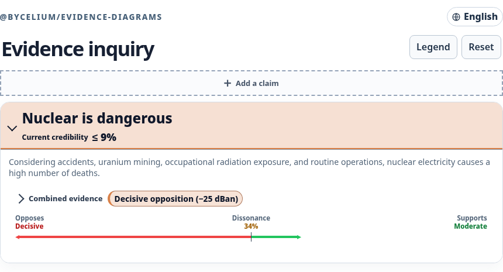
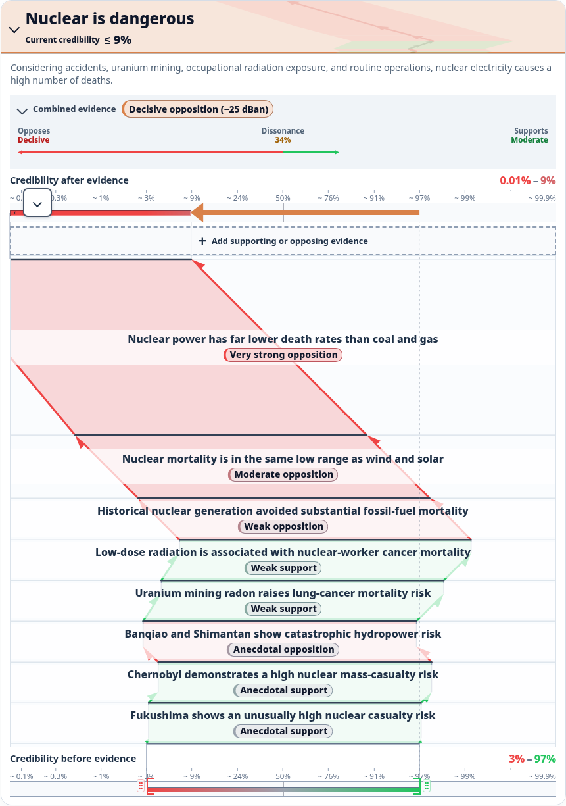
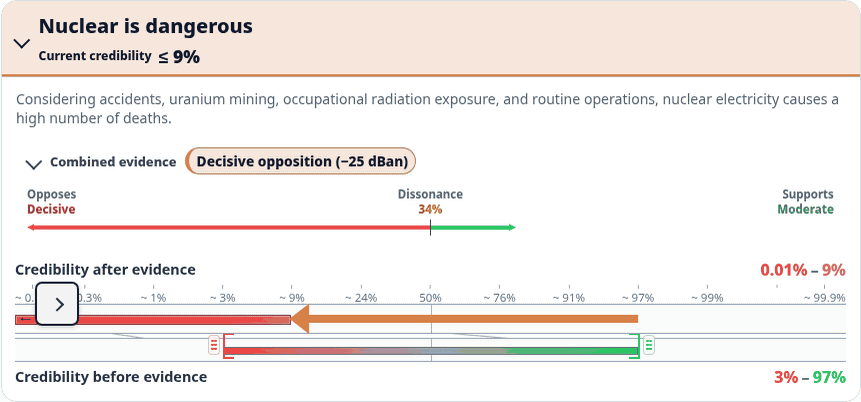
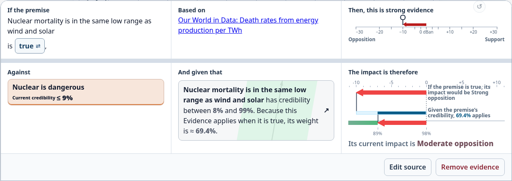
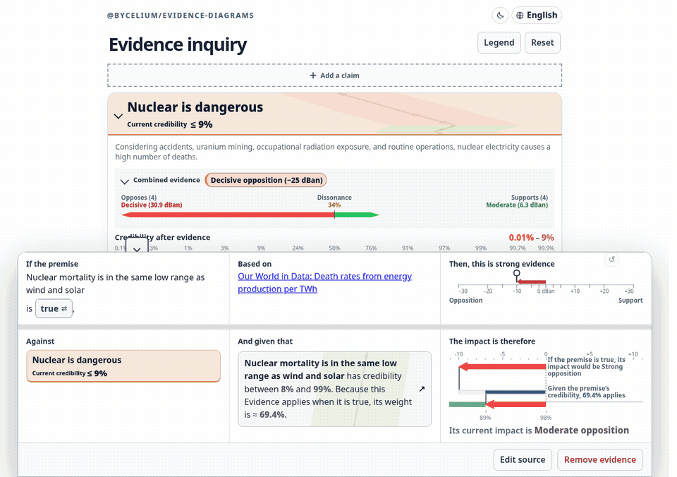
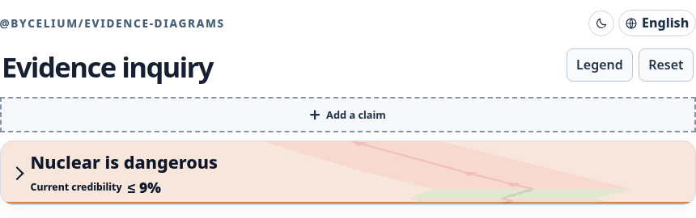

# `@bycelium/evidence-diagrams`

Combine sourced arguments, measure dissonance, and see how each premise changes a claim's credibility.

[Open the live demo](https://evidence.bycelium.com) · [Download the standalone demo](https://raw.githubusercontent.com/Bycelium/EvidenceDiagrams/main/demo/index.html)

The demo runs in English and French, follows the system color preference with a light fallback, and works offline from the downloaded HTML. The sun and moon control stores an explicit light or dark choice. It is compatible with browser extensions such as Dark Reader.

## Demo walkthrough

### 1. Open the claim and its evidence summary



The root card starts with the claim and its current credibility. Open it to reveal **Combined evidence**, which compares accumulated opposition, dissonance, and support.

### 2. Expand the diagram

Open the summary to follow every evidence step from the prior credibility band to the current result.



### 3. Change the starting credibility

Use the inner chevron to collapse the evidence path while keeping the prior and current credibility bands visible. Drag a prior handle to update the inquiry or use ↺ to restore its starting value.

[](https://evidence.bycelium.com)

### 4. Inspect evidence and follow its premise



Select an evidence arrow to see its premise, primary source, conditional force, premise credibility, and current impact. Drag the conditional-force handle to edit the relationship in 1 dBan steps and see its current impact update. Open the premise card to continue into its own evidence subtree.

[](https://evidence.bycelium.com)

### 5. Start another inquiry



Select **Add a claim** above the current root to start an inquiry from a claim and description, then add supporting or opposing evidence with a premise and HTTP(S) source. Switching roots preserves each inquiry while the demo is open. Shared premises and sources stay identifiable across arguments; correlation between distinct arguments is not inferred automatically.

The live legend follows the selected claim and its prior. Read the [Inquiry model](docs/inquiry.md), [nuclear-demo source audit](docs/nuclear-sources.md), and [dependence proposals](docs/proposals/evidence-dependence.md) for details.

## Install

```bash
pnpm add @bycelium/evidence-diagrams
```

<details>
<summary>Inquiry API</summary>

Each claim has a Gaussian prior in decibans. Each evidence relationship names a source contribution, premise, target, and conditional impact.

```ts
import { evaluateInquiry, type Inquiry } from '@bycelium/evidence-diagrams';

const inquiry: Inquiry = {
  rootClaimId: 'nuclear-higher-mortality',
  claims: [
    {
      id: 'nuclear-higher-mortality',
      title: 'Nuclear is dangerous',
      description: 'Nuclear electricity causes a high number of deaths.',
      prior: { mean: 0, standardDeviation: 5 },
    },
    {
      id: 'normalized-comparison',
      title: 'Nuclear death rates are far below coal and gas',
      description: 'Published deaths-per-TWh estimates place nuclear far below coal and gas.',
      prior: { mean: 8, standardDeviation: 2 },
    },
  ],
  contributions: [{
    id: 'owid-energy-mortality',
    title: 'Our World in Data: Death rates from energy production per TWh',
    url: 'https://ourworldindata.org/grapher/death-rates-from-energy-production-per-twh?tab=table',
  }],
  evidence: [{
    id: 'normalized-comparison-effect',
    contributionId: 'owid-energy-mortality',
    premiseClaimId: 'normalized-comparison',
    targetClaimId: 'nuclear-higher-mortality',
    impact: { deltaMean: -20, deltaStandardDeviation: -0.6 },
  }],
};

const result = evaluateInquiry(inquiry, { evidenceOrder: 'weakest-first' });
result.claims['nuclear-higher-mortality'].posterior; // { mean, standardDeviation }
result.claims['nuclear-higher-mortality'].probability; // expected logistic probability
result.claims['nuclear-higher-mortality'].steps; // premise-weighted replay
```

The default demo prior is `{ mean: 0, standardDeviation: 5 }`. The evaluator recursively computes each premise probability, scales the relationship's conditional impact, and replays those impacts for the target. `weakest-first` orders them by ascending absolute weighted mean shift; ties retain evidence-array order.

</details>

<details>
<summary>API reference</summary>

```ts
import {
  aggregateEvidence,
  buildEvidenceDiagram,
  boundProbability,
} from '@bycelium/evidence-diagrams';

const evidence = [
  { id: 'report', weightDecibans: 12 },
  { id: 'counter-analysis', weightDecibans: -5 },
];

const summary = aggregateEvidence(evidence);
summary.netWeightDecibans; // 7
summary.absoluteWeightDecibans; // 17
summary.dissonance; // 10 / 17

const diagram = buildEvidenceDiagram(evidence);
diagram.steps[1].end; // { netWeightDecibans: 7, absoluteWeightDecibans: 17 }
diagram.resultant.jeffreysBand; // 'moderate'
diagram.probability.text; // 'Probability ≥ 13 %'

boundProbability(summary).direction; // 'lower'
```

| Export | Purpose |
|---|---|
| `aggregateEvidence(weights)` | Returns net weight, absolute weight, and dissonance. |
| `probabilityToDecibans({ probability })` | Converts probability to decibans. |
| `decibansToProbability({ weightDecibans })` | Converts decibans to probability. |
| `boundProbability(summary, options?)` | Returns a conservative, exact, or indeterminate probability. |
| `buildEvidenceDiagram(evidence, options?)` | Returns a render-independent diagram model. |
| `jeffreysBand({ weightDecibans })` | Returns `none`, `anecdotal`, `weak`, `moderate`, `strong`, `very strong`, or `decisive`; negative nonzero bands end with ` against`. |
| `color`, `triangleColor`, `trianglePosition` | Provide diagram color and triangular-legend values. |
| `credibilityAxisColor`, `credibilityBandBackground` | Color absolute credibility coordinates and interval bands. |
| `evidenceStrengthColor` | Color an individual evidence effect against an exact neutral prior. |
| `DEFAULT_COLOR_OPTIONS` | Provides default color settings. |

The adapted Jeffreys scale classifies `2.5 ≤ |dBan| < 5` as weak; lower nonzero values remain anecdotal.

`EvidenceWeight` has `weightDecibans`. `EvidenceSummary` has
`netWeightDecibans`, `absoluteWeightDecibans`, and `dissonance`. `Probability`
has `probability`. `ProbabilityBoundsOptions` accepts `minPriorDecibans` and
`maxPriorDecibans`. `ColorOptions` adds `saturationThresholdDecibans` and
`anchors.gray`, `anchors.yellow`, `anchors.green`, and `anchors.red`.

Numeric `ProbabilityBound` values have `direction` (`lower`, `upper`, or
`exact`), `probability`, `displayPercentage`, optional `displayOperator`, and
English `text`. Percentages within 1% of either endpoint use enough decimal
precision to avoid finite certainty claims. `displayOperator` supplies the
strict or conservative comparator when the capped precision reaches 0% or
100%. An indeterminate value has `direction: 'indeterminate'`, a `reason` of
`'no-evidence'` or `'dissonant-evidence'`, and English `text`.

The default prior interval is `[-15, +15] dBan`, and the default color
saturation threshold is `15 dBan`. Full directional color begins when the
conservative posterior endpoint reaches `±15 dBan`, roughly 97% or 3%. With
the default priors, that occurs at `±30 dBan` net evidence. The diagram keeps
raw decibans in its steps and resultant so a consumer can choose its own
projection. Its visible axis spans twice the saturation threshold on each side,
or `±30 dBan` by default.

</details>

<details>
<summary>Development and localization</summary>

```bash
pnpm install
pnpm build:demo
pnpm check
```

`build:demo` regenerates the standalone `demo/index.html` page. To regenerate the
favicon PNGs from their editable SVG source, run `pnpm build:demo-assets`; it
requires the Inkscape CLI. `check` runs the project checks and consumer installation
test. To add a locale, implement the consuming features’ typed message domains under
`demo/src/i18n/locales/`, then register the locale in `demo/src/i18n/index.ts`.

Capture the README screenshots and animations from the generated demo with:

```bash
node scripts/capture-guide-media.mjs --output-dir /tmp/evidence-guide \
  --playwright-module /path/to/@playwright/test/index.mjs --ffmpeg-path /path/to/ffmpeg
```

For deployment, serve `demo/` as the site root so `index.html`,
`robots.txt`, `sitemap.xml`, and the favicon PNGs are available at their root paths.
The generated page remains a self-contained offline demo.

</details>

Apache-2.0. See [LICENSE](LICENSE) and [NOTICE](NOTICE).
