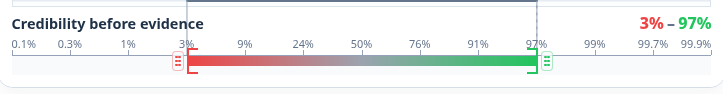
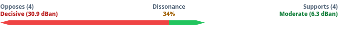
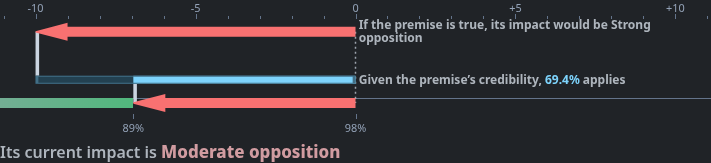

# `@bycelium/evidence-diagrams-dom`

Native DOM and SVG presentations for Evidence Diagrams credibility intervals,
supporting and countering summaries, and one-step evidence impacts.

```bash
pnpm add @bycelium/evidence-diagrams @bycelium/evidence-diagrams-dom
```

Import the rendering functions from the package and opt in to its scoped styles:

```ts
import {
  renderCollapsedEvidenceSummary,
  renderCredibilityAxis,
  renderEvidenceImpactPreview,
} from '@bycelium/evidence-diagrams-dom';
import '@bycelium/evidence-diagrams-dom/styles.css';
```

## Components

`renderCredibilityAxis` shows a bounded credibility interval with probability
rulers and optional editing affordances.



`renderCollapsedEvidenceSummary` shows accumulated Supporting and Countering
mean changes on one centered line.



`renderEvidenceImpactPreview` shows the conditional impact, premise weighting,
and resulting current impact. The package styles support light and dark themes.



The package reads the DOM only when a render function is called. Importing it in
a server or build process is safe. Consumers provide localized text and numeric
formatters. The stylesheet exposes `--ed-dom-*` custom properties for theme
integration and does not reset global fonts or page styles.

From the repository root, capture the repository README screenshots, GIFs, and social preview with `pnpm screenshots`. Install Chromium once with `pnpm exec playwright install chromium` (see [Playwright browser setup](https://playwright.dev/docs/browsers)). Non-Nix environments also need `ffmpeg` and `ffprobe` on PATH. To stage them outside the repository or override local tooling, run:

```bash
node scripts/capture-guide-media.mjs --readme-media --output-dir /tmp/evidence-readme --playwright-module /path/to/playwright --browser-path /path/to/chromium
```

See the [core calculation package](https://www.npmjs.com/package/@bycelium/evidence-diagrams) and the
[repository README](https://github.com/Bycelium/EvidenceDiagrams#readme) for the standalone demonstration.

Apache-2.0. See [LICENSE](LICENSE) and [NOTICE](NOTICE).
